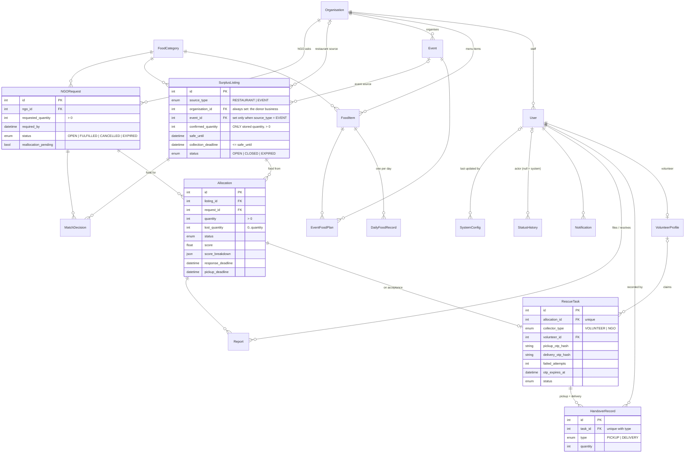

# ER diagram

The source of truth is `backend/prisma/schema.prisma`. The diagram below is written in Mermaid, which GitHub renders automatically.

## Constraints

Most of these are written by hand at the end of the migration files (`prisma/migrations/*/migration.sql`). The unique constraints come from `schema.prisma`.

| Constraint | Rule |
|---|---|
| `chk_listing_source` | `organisation_id` is always set (NOT NULL); `event_id` is set exactly when `source_type` is EVENT |
| `chk_org_ngo_fields` | an NGO must have `ngo_type`; donor businesses cannot have `ngo_type`, `beneficiaries` or `show_in_directory` |
| `chk_donor_org_licence` | a donor business (restaurant, marquee / caterer) must have a licence number and authority; NGOs need none |
| `chk_listing_deadline` | `collection_deadline <= safe_until` |
| `chk_*_qty_positive` / `chk_*_nonneg` | quantities, capacities and attempts are never negative |
| `chk_alloc_lost_range` | `0 <= lost_quantity <= quantity` |
| `chk_task_claimed_has_volunteer` | a claimed or picked-up volunteer task names its volunteer |
| unique | `users.email`; `organisations(licence_authority, licence_number)`; `handover_records(task_id, type)`; `rescue_tasks.allocation_id`; `daily_food_records(food_item_id, date)` |
| indexes | status plus deadline columns on listings, requests, allocations and tasks, which the sweep's cheap check uses |

## Derived quantities

These are never stored. They are calculated in `src/lib/quantities.js`.

- **Listing committed** = sum of `quantity` over its allocations in PROPOSED, ACCEPTED, PICKED_UP, DELIVERED or FAILED.
- **Listing remaining** = `confirmed_quantity` minus committed. A REJECTED, EXPIRED or CANCELLED allocation stops counting, so its food is released automatically.
- **Request covered** = sum of `quantity - lost_quantity` over its allocations in PROPOSED, ACCEPTED, PICKED_UP or DELIVERED. FAILED does not count, so the need opens again.
- **Delivered (Rescued)** = sum of `quantity - lost_quantity` over DELIVERED allocations.
