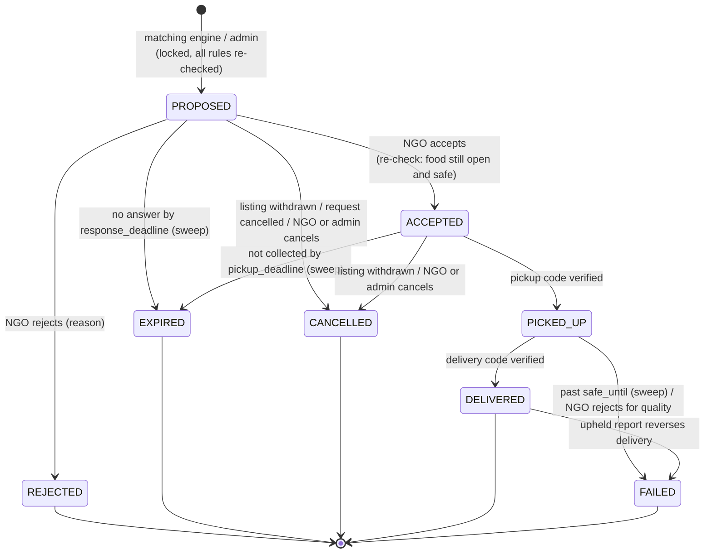
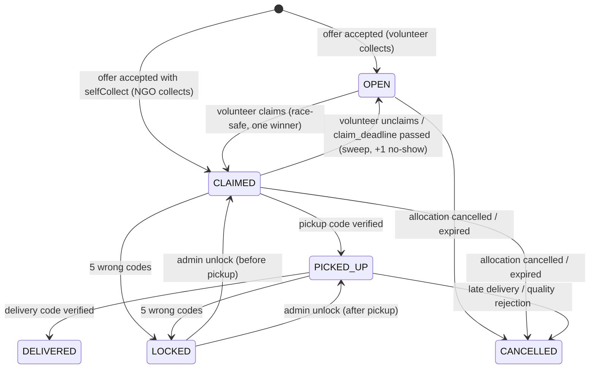
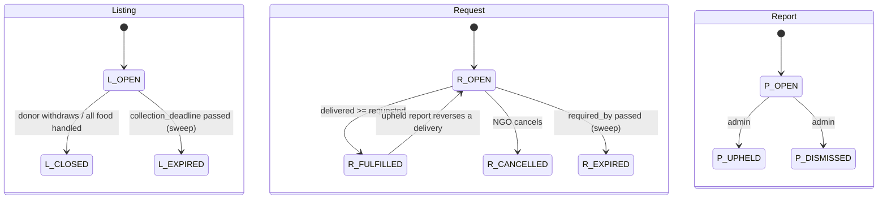

# State machines

Every transition writes a `status_history` row. `actor_user_id` is null when the system made the change (the sweep).

## Allocation

REJECTED, EXPIRED and CANCELLED **release** their food, because it stops counting in the derived quantities. The request is flagged `reallocation_pending`, and the next matching run offers the food again.

## Rescue task

## Listing, request, report

